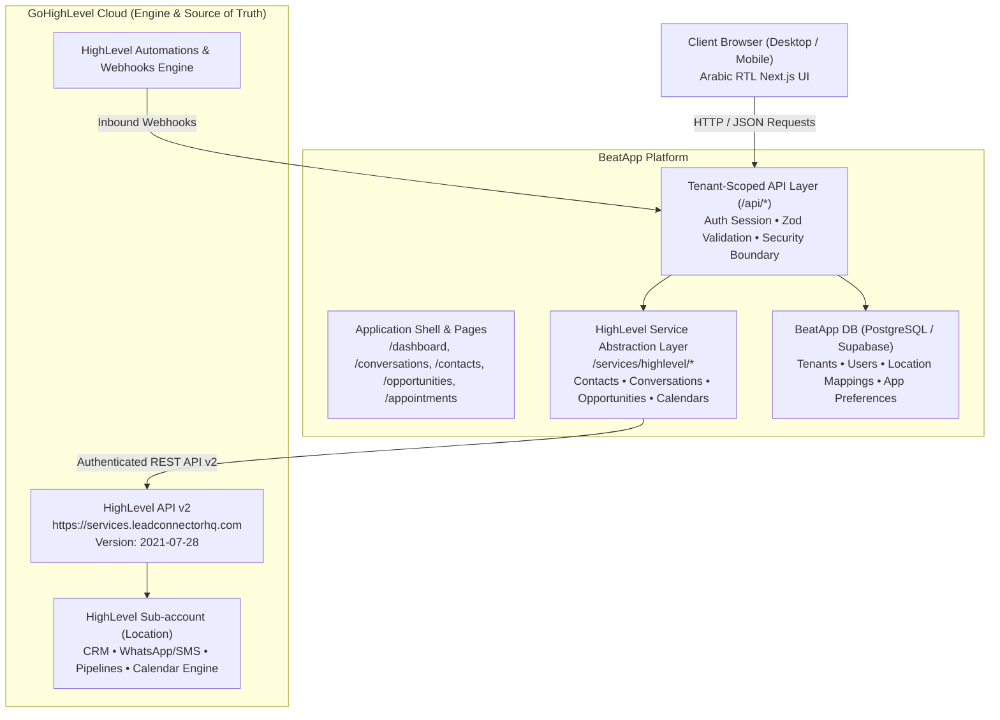
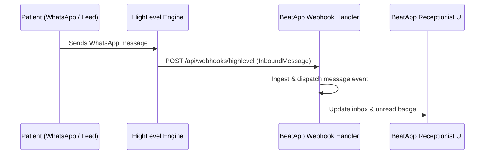

# BeatApp Technical Architecture (ARCHITECTURE.md)

This document describes the high-level system architecture, integration boundaries, security model, and multi-tenancy implementation for **BeatApp**.

---

## 1. High-Level Architectural Flow



---

## 2. Core Architectural Principles

### A. HighLevel as the Engine & Single Source of Truth
BeatApp deliberately avoids maintaining a duplicate local CRM database. When a customer is added, a message is sent, or a pipeline stage is updated, the operation executes against HighLevel's API. HighLevel executes workflows, sends WhatsApp/SMS dispatches, triggers follow-ups, and logs the activity.

### B. Purpose-Built MedSpa Abstraction
HighLevel provides broad, generic configurability. BeatApp narrows this down to what a MedSpa receptionist or sales rep needs:
- Natural Arabic terminology suited for aesthetic clinics
- 7 tailored MedSpa pipeline stages
- Integrated chat inbox without CRM noise
- Direct appointment timeline

### C. Zero Exposure of Secrets
The client browser never sees HighLevel API tokens, Private Integration Tokens, OAuth client secrets, or direct database credentials. The Next.js API routes act as the secure mediator.

---

## 3. HighLevel Integration Layer (`/services/highlevel/`)

The integration layer is structured into modular domain services:

```
src/services/highlevel/
├── client.ts             # Base HTTP client with headers, error handling & config resolution
├── contacts.ts           # Contacts API (Search, Create, Get, Add Note)
├── conversations.ts      # Conversations & Message Send / Retrieve
├── opportunities.ts      # Opportunity Pipelines & Stage Transitions
├── calendars.ts          # Appointments & Calendar Events
├── webhooks.ts           # Webhook Ingestion & Event Dispatch
├── mock-store.ts         # In-memory dynamic store for DEMO_MODE & Sandbox
```

### HighLevel API Specs
* **API Base URL**: `https://services.leadconnectorhq.com`
* **Required Headers**:
  - `Authorization: Bearer <token>`
  - `Version: 2021-07-28`
  - `Content-Type: application/json`

---

## 4. Multi-Tenancy Strategy

Each MedSpa represents a **Tenant** associated with one **HighLevel Location ID**:

```
Tenant (e.g. Lumina MedSpa)
  ├── id: "tenant-lumina-medspa"
  ├── locationId: "loc_xxxx" (HighLevel Sub-Account)
  ├── users: [Receptionist, Doctor, Sales, Clinic Manager]
  └── highlevelCredentials:
        ├── mode: "private_token" (or "oauth")
        └── token: encrypted_token
```

### Request Flow & Isolation
1. When a user authenticates, their session identifies their `tenantId` and corresponding `locationId`.
2. Every API route (`/api/contacts`, `/api/conversations`, etc.) automatically derives the tenant context from the session.
3. The client never provides or modifies the `locationId` in request parameters, preventing cross-tenant data leakage.

---

## 5. Webhooks & Real-Time Synchronization

HighLevel triggers webhooks to BeatApp at `/api/webhooks/highlevel`:



---

## 6. Development & Sandbox Mode (`DEMO_MODE=true`)

To guarantee smooth development, testing, and UI evaluation even before live HighLevel API credentials are provided:
- If `HIGHLEVEL_PRIVATE_TOKEN` is unset or `DEMO_MODE=true`, BeatApp smoothly delegates calls to `mockStore`.
- `mockStore` is dynamic and in-memory: creating a contact, sending a message, or changing a deal stage persists across the session.
- A prominent status banner in the UI informs the user of the active mode with instructions to switch to live mode.
